**Département des Technologies de l'Information et de la Communication (TIC)**

# Gestion des réseaux et sécurité opérationnelle (GRS)

## Laboratoire #2 - SNMP

**Étudiant :** Amine Khelfi

**Professeur :** Prof. Sergio Alves Domingues

**Date :** 18.10.2026

---

# 1. Introduction

## 1.1. Objectifs

Mettre en œuvre SNMP : console snmpB, agents v2c (Windows, Cisco, Linux), analyse des échanges, MIBs privées et SNMP v3.

## 1.2. Infrastructure

| Machine | Rôle | Adresse IP |
|---|---|---|
| Windows 10 | Console snmpB, Wireshark, agent SNMP | `192.168.201.100` |
| Ubuntu | Agent snmpd | `192.168.201.101` |
| Cisco CSR 1000V | Agent SNMP | `192.168.201.102` |

---

# 2. SNMP

## 2.1. Configuration d'un « SNMP Manager »

Profils snmpB : `localhost` et `Ubuntu` (communauté `grs-read-only`), `Cisco` (`ciscoRO` / `ciscoRW`).

## 2.2. Configuration des agents en SNMP v2c

### 2.2.1. Poste de travail Windows

> **QUESTION 1 [2 pts]**
>
> Montrez à l'aide de captures d'écran les changements de configuration réalisés.

Service SNMP, onglet **Sécurité** : communauté `grs-read-only` en lecture seule, paquets acceptés depuis `localhost` uniquement.

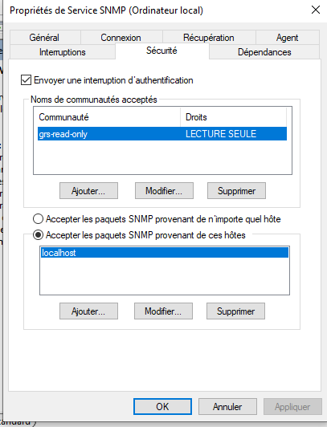

> **QUESTION 2 [1 pts]**
>
> Montrez les valeurs retournées par les 4 objets `SysDescr`, `SysName`, `SysUpTime`, `ifNumber` et l'adresse IP de votre machine.

| Objet | Valeur |
|---|---|
| sysDescr | Hardware: Intel64 Family 6 Model 154 Stepping 4 AT/AT COMPA... |
| sysName | win10-GRS-A |
| sysUpTime | 0:07:55.94 |
| ifNumber | 28 |
| Adresse IP | 192.168.201.100 |

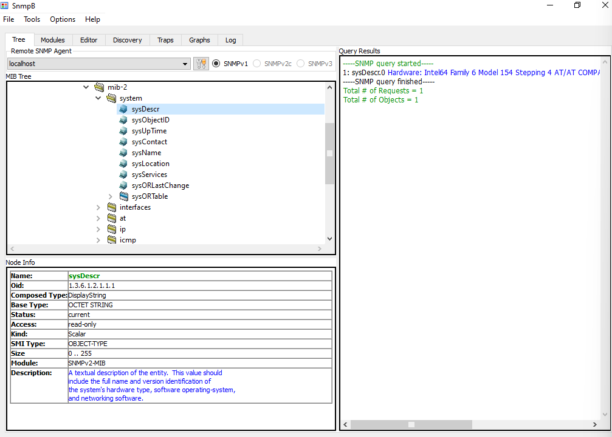

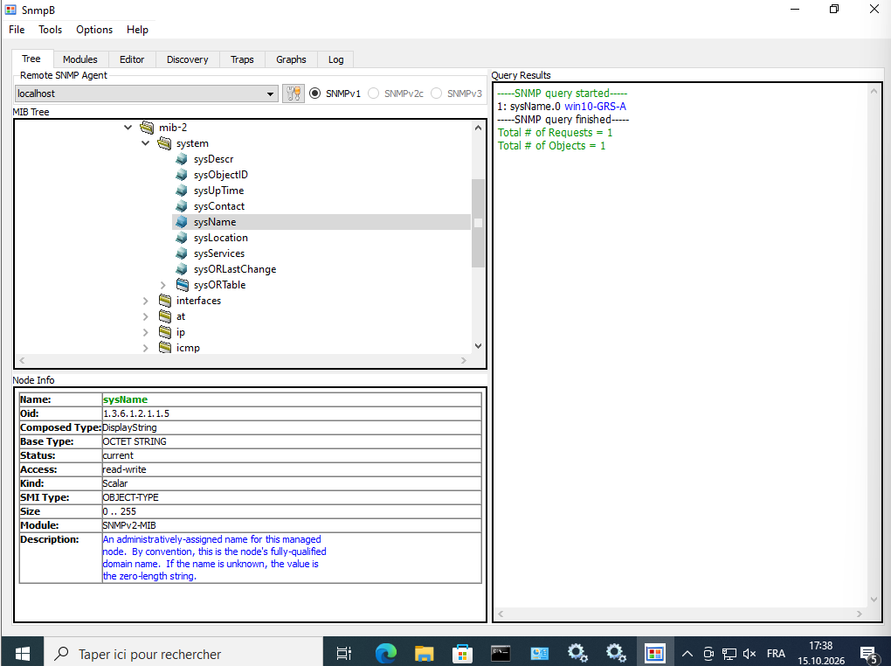

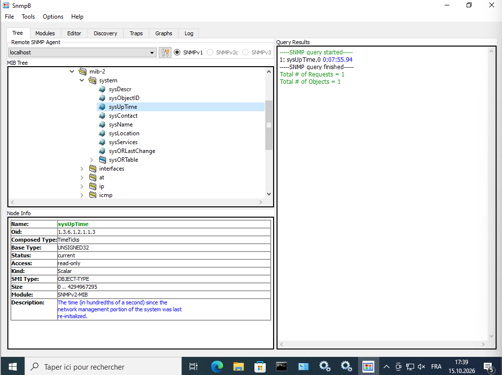

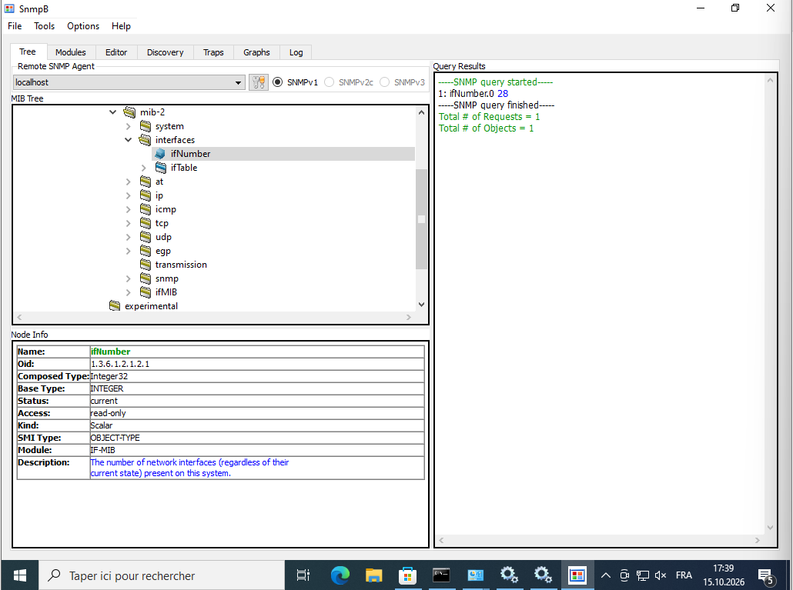

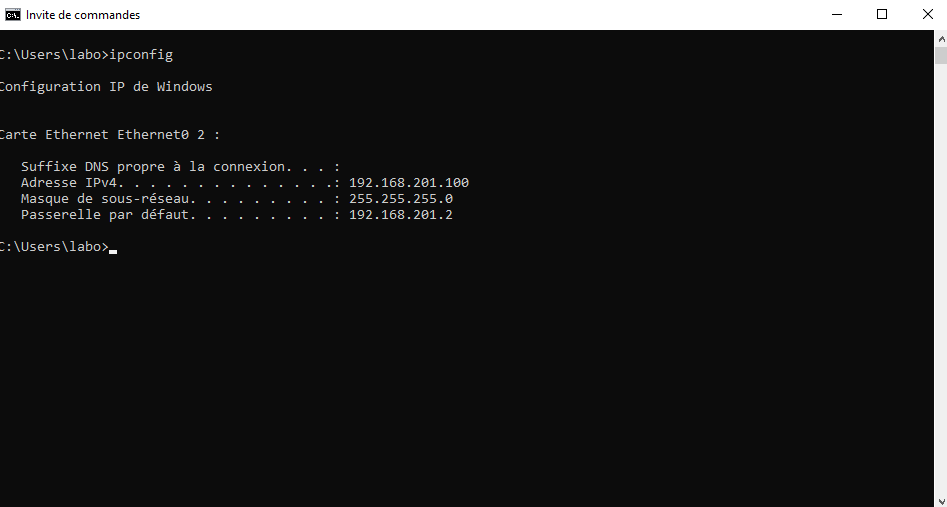

### 2.2.2. Routeur Cisco

> **QUESTION 3 [2 pts]**
>
> Indiquez les commandes utilisées pour mettre en place la configuration SNMP demandée ci-dessus, sur le routeur Cisco.

```bash
enable
configure terminal

! SNMP v2c
snmp-server community ciscoRO RO
snmp-server community ciscoRW RW
snmp-server location HEIG-VD Labo GRS
snmp-server contact amine.khelfi@heig-vd.ch

! Traps vers snmpB
snmp-server host 192.168.201.100 version 2c ciscoRO
snmp-server enable traps snmp authentication linkdown linkup coldstart warmstart
snmp-server enable traps config

! Horodatage à la milliseconde
service timestamps debug datetime msec localtime show-timezone
service timestamps log datetime msec localtime show-timezone

! Synchronisation du temps
clock timezone CET 1 0
clock summer-time CEST recurring last Sun Mar 2:00 last Sun Oct 3:00
ntp server 195.176.26.205

end
write memory
```

- `snmp-server community ... RO/RW` active l'agent SNMP v1/v2c avec une communauté en lecture seule (`ciscoRO`) et une en lecture/écriture (`ciscoRW`), comme dans le profil snmpB.
- `snmp-server host ... version 2c ciscoRO` désigne snmpB comme destinataire des traps. `snmp-server enable traps` choisit les notifications émises (état des interfaces, redémarrage, échec d'authentification, changement de configuration).
- `service timestamps ... msec` ajoute les millisecondes aux messages.
- Le fuseau CET/CEST et le serveur NTP (METAS, cf. Labo 1) garantissent des horodatages exacts et comparables entre équipements.

> **QUESTION 4 [1 pts]**
>
> Montrez les valeurs retournées par les 4 objets `SysDescr`, `SysName`, `SysUpTime`, `sysObjectID` et l'adresse IP de votre routeur.

| Objet | Valeur |
|---|---|
| sysDescr | Cisco IOS Software [Amsterdam], Virtual XE Software (X8... |
| sysName | GRS_rtr |
| sysUpTime | 7:00:43.72 |
| sysObjectID | enterprises.9.1.1537 |
| Adresse IP | 192.168.201.102 (GigabitEthernet1) |

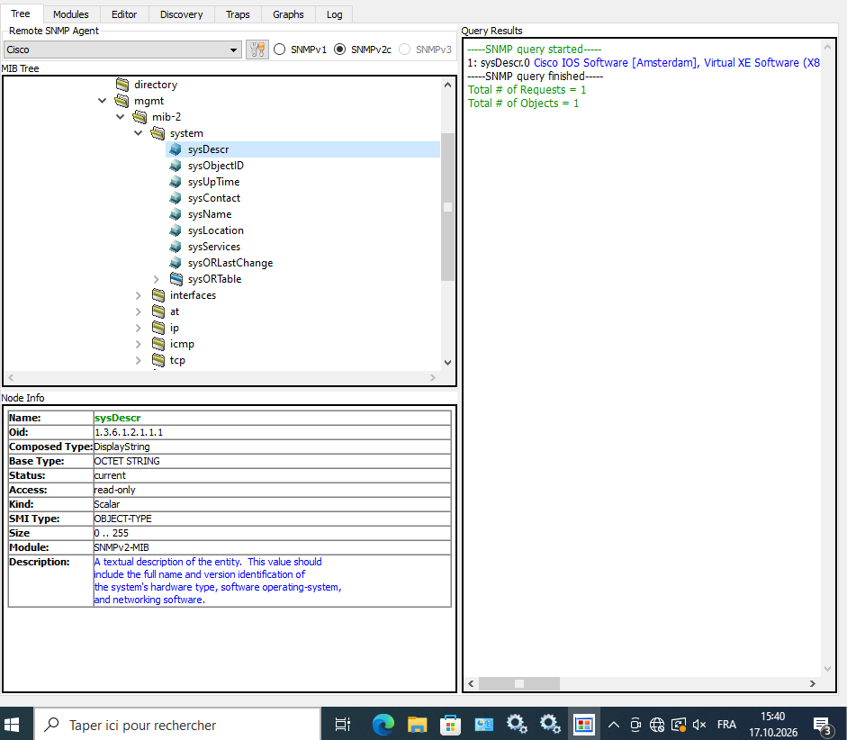

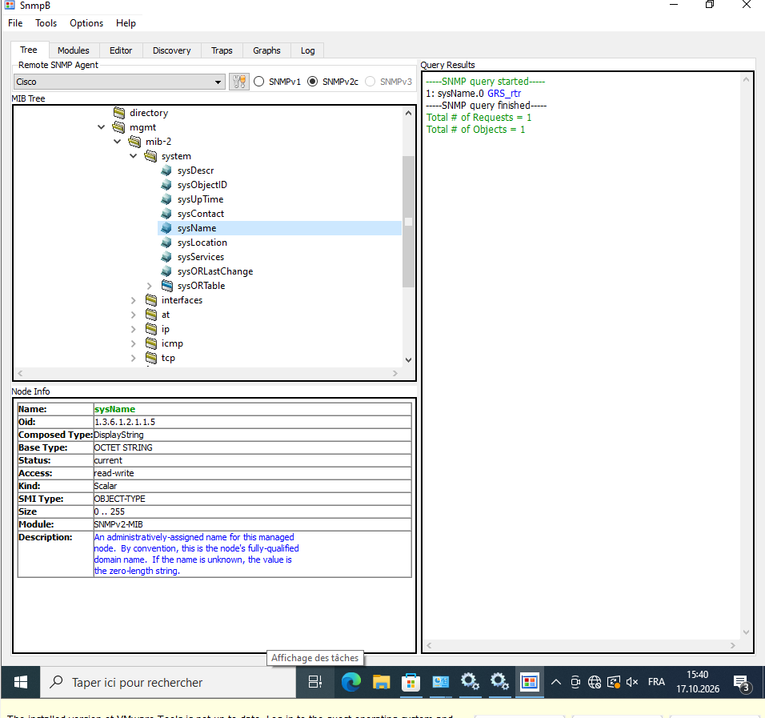

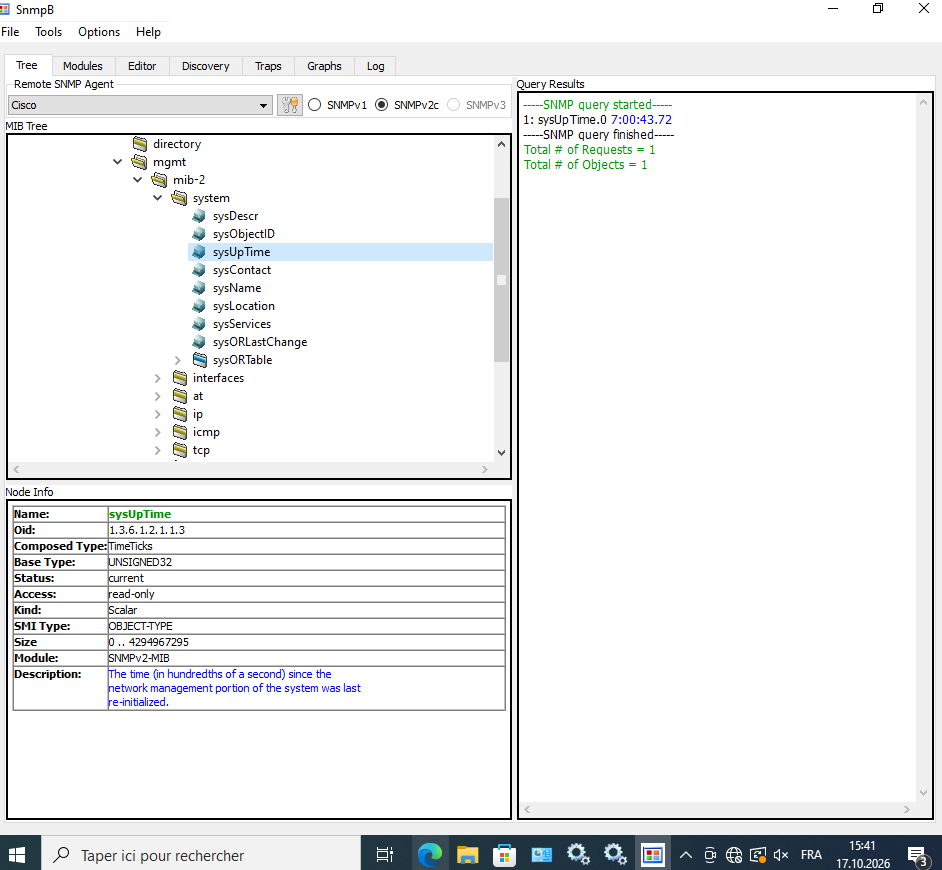

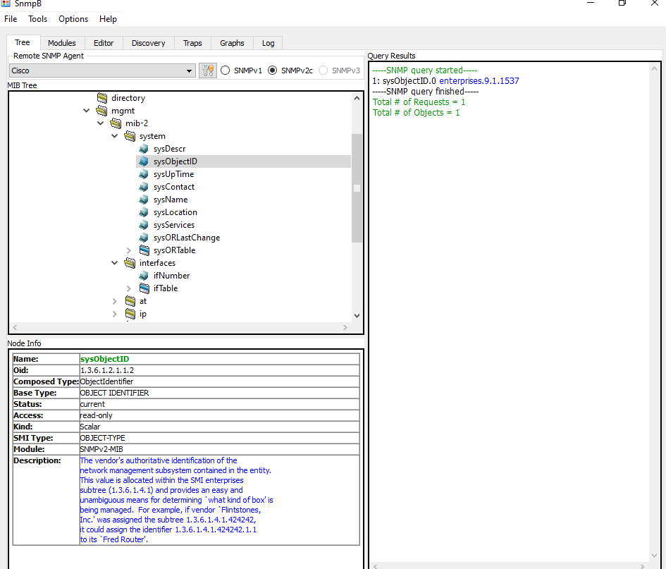

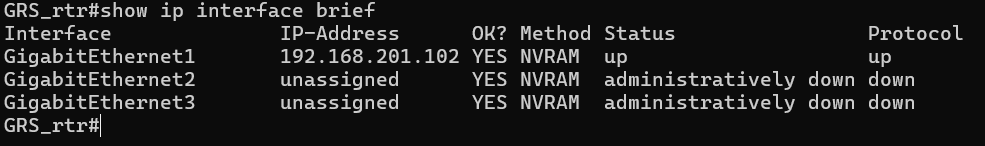

> **QUESTION 5 [1 pts]**
>
> A quoi sert/correspond la valeur retournée par sysObjectID ? Que vous manque-t-il pour l'interpréter correctement ?

`sysObjectID` identifie le **modèle d'équipement** avec un OID attribué par le constructeur. Un manager SNMP sait ainsi de quel type d'appareil il s'agit, sans devoir analyser le texte libre de `sysDescr`.

Décomposition de `1.3.6.1.4.1.9.1.1537` :
- `1.3.6.1.4.1` : branche `enterprises` (OID privés des constructeurs) ;
- `9` : numéro d'entreprise IANA de Cisco ;
- `1` : `ciscoProducts` ;
- `1537` : identifiant du modèle.

Pour l'interpréter, il manque les **MIBs privées Cisco** : `CISCO-SMI`, qui définit la racine Cisco et `ciscoProducts`, et `CISCO-PRODUCTS-MIB`, qui associe le numéro `1537` au nom du modèle (ici un CSR 1000V, cf. sysDescr « Virtual XE Software »).

> **QUESTION 6 [1 pts]**
>
> Utilisez snmpB pour **obtenir** le nom (`SysName`) de votre routeur Cisco. Montrez les trames réseau correspondant à cet échange et commentez-les.

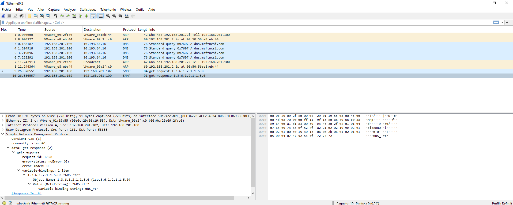

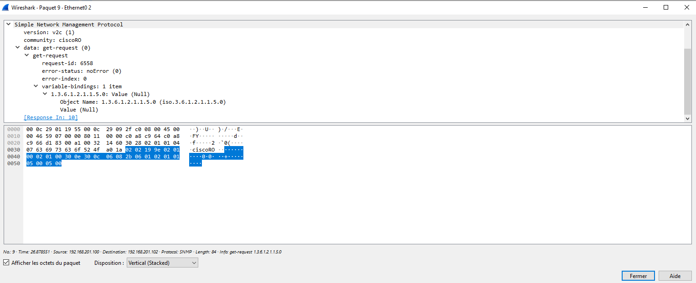

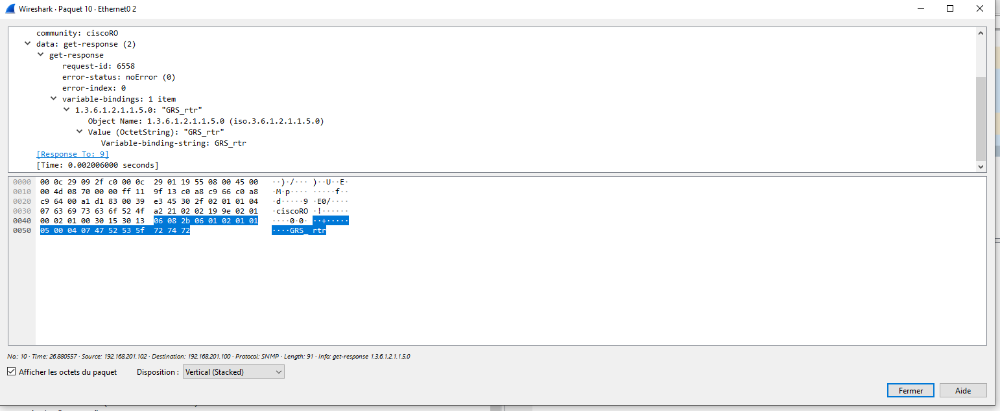

| Trame | Sens | Ports UDP | PDU | Contenu |
|---|---|---|---|---|
| 9 | 192.168.201.100 → 192.168.201.102 | 53635 → 161 | `get-request` | v2c, communauté `ciscoRO`, request-id 6558, OID `1.3.6.1.2.1.1.5.0`, valeur Null |
| 10 | 192.168.201.102 → 192.168.201.100 | 161 → 53635 | `get-response` | request-id 6558, `noError (0)`, valeur `"GRS_rtr"` |

Le manager envoie un GET à l'agent sur le port 161. La valeur est **Null** car la requête indique seulement l'OID à lire. L'agent répond avec le **même request-id**, ce qui permet d'associer la réponse à la requête (Wireshark : « Response In: 10 »). La communauté et la valeur sont lisibles **en clair**, y compris dans les octets bruts : SNMPv2c n'offre ni authentification forte ni chiffrement.

> **QUESTION 7 [1 pts]**
>
> Utilisez snmpB pour **modifier** le nom de l'équipement (`SysName`). Nommez-le avec votre prénom, de la manière suivante : `router-prenom`. Montrez les trames réseau correspondant à cet échange et commentez-les.

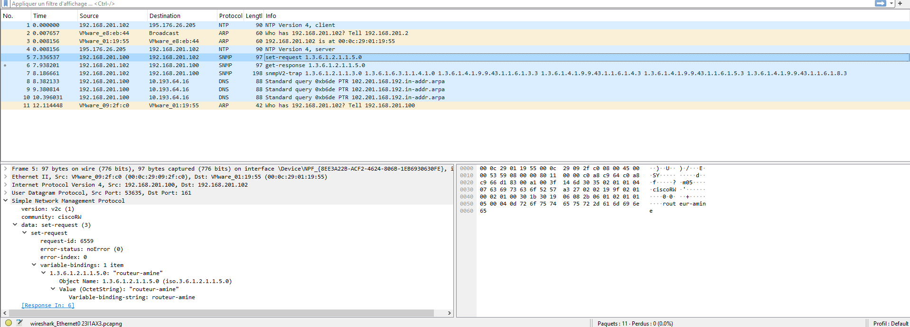

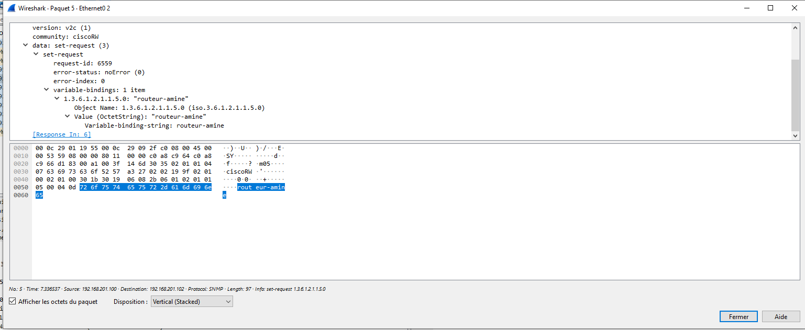

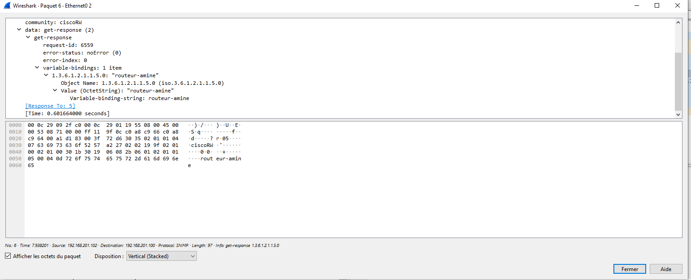

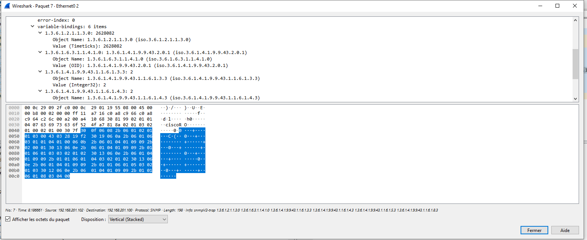

| Trame | Sens | Ports UDP | PDU | Contenu |
|---|---|---|---|---|
| 5 | 192.168.201.100 → 192.168.201.102 | 53635 → 161 | `set-request` | v2c, communauté `ciscoRW`, request-id 6559, OID `1.3.6.1.2.1.1.5.0` = `"routeur-amine"` |
| 6 | 192.168.201.102 → 192.168.201.100 | 161 → 53635 | `get-response` | request-id 6559, `noError (0)`, valeur confirmée `"routeur-amine"` |
| 7 | 192.168.201.102 → 192.168.201.100 | → 162 | `snmpV2-trap` | `ciscoConfigManEvent` (changement de configuration) |

Contrairement au GET, le SET exige une communauté avec **droits d'écriture** (`ciscoRW`). Avec `ciscoRO`, le routeur refuserait l'opération. Le manager envoie directement la nouvelle valeur. L'agent l'applique, puis la renvoie dans un `get-response` portant le même request-id. Le changement de configuration déclenche ensuite un trap vers snmpB (trame 7).

La communauté RW et la nouvelle valeur circulent **en clair** : quiconque capture ce trafic peut réutiliser `ciscoRW` pour modifier le routeur.

*Remarque : la consigne demandait `router-amine`. Le nom saisi est `routeur-amine`, ce qui ne change rien à l'échange observé.*

> **QUESTION 8 [1 pts]**
>
> Montrez un message (*Trap*) reçu par l'application snmpB.

Événement : arrêt puis réactivation d'une interface Loopback, en deux étapes séparées.

```bash
configure terminal
interface Loopback1
 ip address 1.1.1.1 255.255.255.255
 shutdown
end
! quelques secondes plus tard
configure terminal
interface Loopback1
 no shutdown
end
```

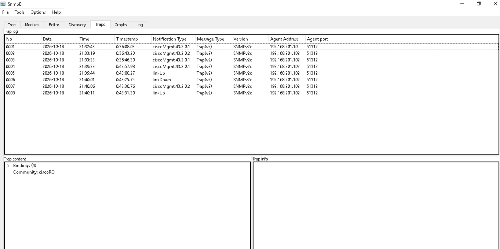

snmpB reçoit un trap **linkDown** puis un trap **linkUp** du routeur, ainsi que des traps `enterprises.9.9.43...` liés aux changements de configuration (affichés en numérique, car la MIB Cisco correspondante n'est pas chargée).

> **QUESTION 9 [1 pts]**
>
> Montrez la trame réseau correspondante dans Wireshark.

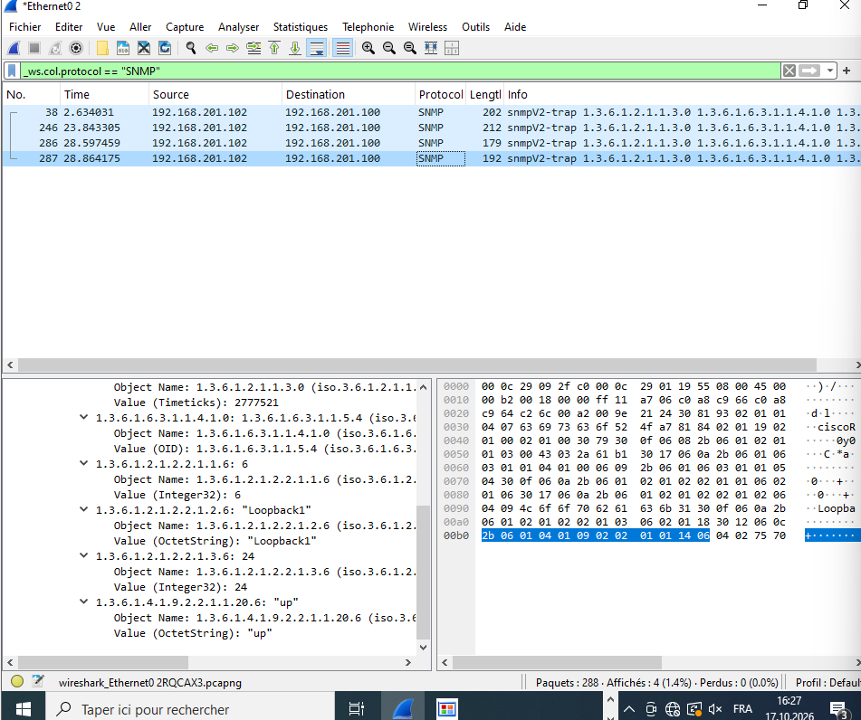

Trame 287 : `snmpV2-trap` de `192.168.201.102` vers `192.168.201.100`, port UDP **162**, version v2c, communauté `ciscoRO`.

| Varbind | Valeur |
|---|---|
| sysUpTime.0 (`1.3.6.1.2.1.1.3.0`) | 2777521 centièmes de seconde |
| snmpTrapOID.0 (`1.3.6.1.6.3.1.1.4.1.0`) | `1.3.6.1.6.3.1.1.5.4` (**linkUp**) |
| ifIndex.6 | 6 |
| ifDescr.6 | `"Loopback1"` |
| ifType.6 | 24 (softwareLoopback) |
| locIfReason.6 (OID Cisco `1.3.6.1.4.1.9.2.2.1.1.20.6`) | `"up"` |

Le trap est envoyé **spontanément** par l'agent, sans requête préalable et sans réponse du manager (notification non confirmée). Les deux premiers varbinds (`sysUpTime` et `snmpTrapOID`) sont **obligatoires** dans un trap SNMPv2. Les suivants identifient l'interface concernée.

> **QUESTION 10 [2 pts]**
>
> Indiquez les commandes utilisées pour mettre en place ce filtrage sur le routeur Cisco.

```bash
configure terminal
access-list 10 permit host 192.168.201.100
access-list 10 deny any log
snmp-server community ciscoRO RO 10
snmp-server community ciscoRW RW 10
end
write memory
```

L'ACL standard 10 n'autorise que l'hôte `192.168.201.100`. Liée aux communautés (`snmp-server community <nom> <droits> 10`), elle fait **ignorer** les requêtes SNMP venant de toute autre adresse. `deny any log` journalise les tentatives refusées.

Limite : l'adresse source d'un paquet UDP peut être usurpée, et la communauté circule toujours en clair. Ce filtrage réduit l'exposition, sans remplacer SNMPv3.

### 2.2.3. Poste de travail Linux

> **QUESTION 11 [2 pts]**
>
> Montrez le(s) fichier(s) de configuration nécessaire(s) à la configuration de SNMP (v2c) sur votre machine Linux.

Fichier `/etc/snmp/snmpd.conf` :

```bash
sysLocation    HEIG-VD Labo GRS
sysContact     amine.khelfi@heig-vd.ch

# Écouter sur toutes les interfaces
#agentaddress  127.0.0.1,[::1]
agentaddress  udp:161,udp6:[::1]:161

# Vue sur tout l'arbre MIB
view   all    included   .1

# Communauté v2c en lecture seule, limitée à la VM Windows
rocommunity  grs-read-only  192.168.201.100   -V all
```

```bash
sudo systemctl restart snmpd
sudo systemctl enable snmpd
```

- `agentaddress udp:161` fait écouter l'agent sur toutes les interfaces. Par défaut, il n'écoute que sur `127.0.0.1` et serait injoignable depuis Windows.
- `view all included .1` crée une vue couvrant tout l'arbre MIB. La vue par défaut `systemonly` est limitée à quelques branches.
- `rocommunity grs-read-only 192.168.201.100 -V all` définit une communauté en **lecture seule**, acceptée uniquement depuis la machine Windows.

> **QUESTION 12 [1 pts]**
>
> Montrez le résultat d'une requête SNMP visant à obtenir la description du système (`sysDescr`).

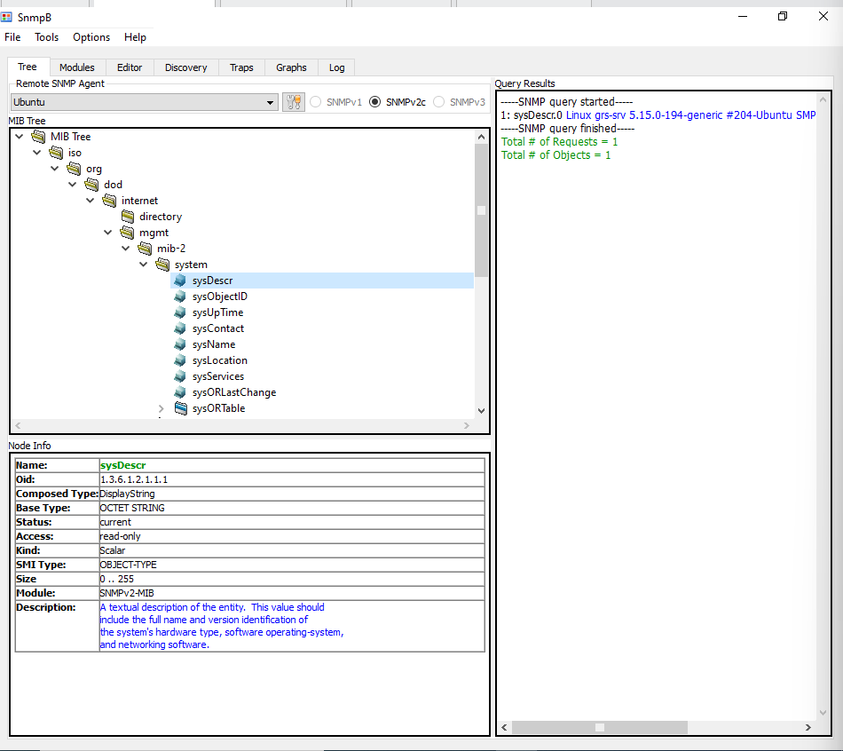

Réponse en SNMPv2c : `Linux grs-srv 5.15.0-194-generic #204-Ubuntu SMP ...`

## 2.3. MIBs privées

> **QUESTION 13 [2 pts]**
>
> Donnez la liste des fichiers MIBs que vous avez chargés et expliquez comment vous êtes arrivé·e à ce résultat.

MIBs chargées : `CISCO-FLASH-MIB`, `CISCO-SMI`, `ENTITY-MIB`, `INET-ADDRESS-MIB`, `HCNUM-TC`, `CISCO-QOS-PIB-MIB`, `CISCO-PRODUCTS-MIB`.

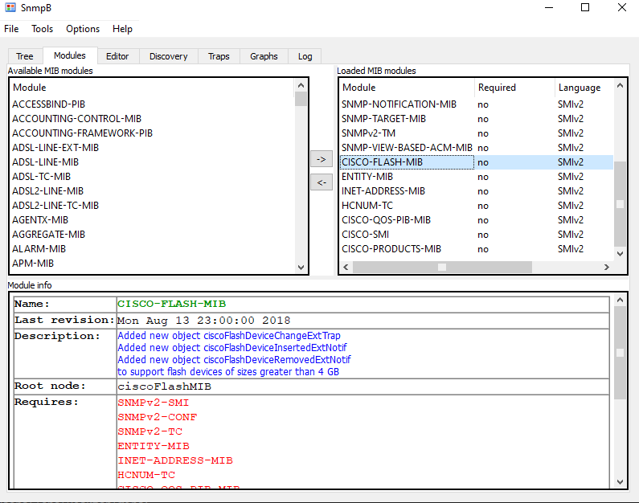

| MIB | Rôle |
|---|---|
| `CISCO-FLASH-MIB` | MIB privée décrivant la mémoire flash : périphériques, partitions, table des fichiers |
| `CISCO-SMI` | Racine de l'arbre Cisco (`enterprises.9`) |
| `ENTITY-MIB`, `INET-ADDRESS-MIB`, `HCNUM-TC`, `CISCO-QOS-PIB-MIB` | Dépendances de `CISCO-FLASH-MIB` |
| `CISCO-PRODUCTS-MIB` | Traduction du `sysObjectID` (Q5) |

Démarche :
1. La mémoire flash est un objet propre à Cisco : il faut une MIB privée. Dans le dépôt des MIBs Cisco, celle qui la décrit est `CISCO-FLASH-MIB`.
2. Après l'avoir copiée dans `C:\Program Files (x86)\SnmpB\mibs` et chargée (onglet *Modules*), snmpB liste ses dépendances dans le champ **Requires**, d'après la section `IMPORTS` du fichier. Les MIBs standards SNMPv2 sont déjà fournies.
3. Les dépendances manquantes ont été ajoutées, puis snmpB relancé, jusqu'à ce que le module se charge sans erreur et que l'arbre `cisco → ciscoMgmt → ciscoFlashMIB` apparaisse.

> **QUESTION 14 [1 pts]**
>
> Montrez, via une requête snmpB, le nom des 10 premiers fichiers stockés sur la mémoire flash de votre routeur Cisco.

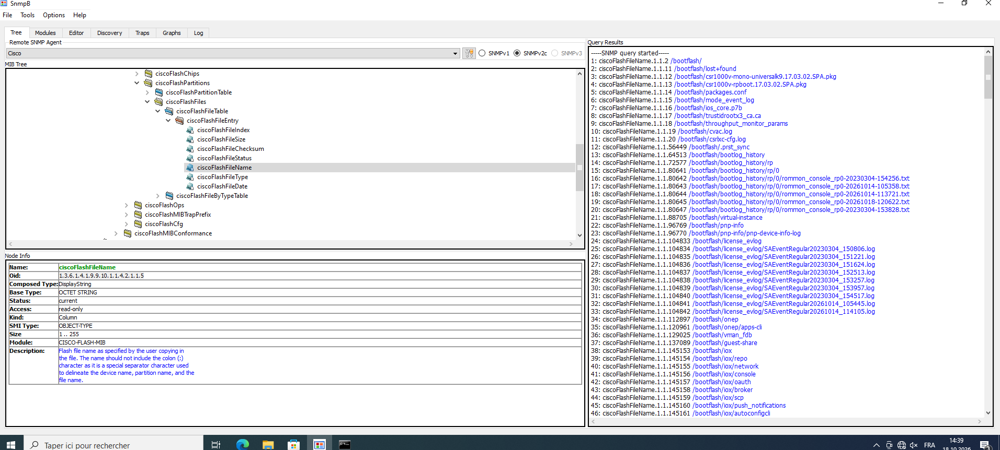

Walk sur `ciscoFlashFileName` (`1.3.6.1.4.1.9.9.10.1.1.4.2.1.1.5`) :

```
1: /bootflash/
2: /bootflash/lost+found
3: /bootflash/csr1000v-mono-universalk9.17.03.02.SPA.pkg
4: /bootflash/csr1000v-rpboot.17.03.02.SPA.pkg
5: /bootflash/packages.conf
6: /bootflash/mode_event_log
7: /bootflash/ios_core.p7b
8: /bootflash/trustidrootx3_ca.ca
9: /bootflash/throughput_monitor_params
10: /bootflash/cvac.log
```

Les entrées 1 et 2 sont des répertoires. L'image IOS XE du routeur (`csr1000v-*.pkg`) et son fichier de démarrage `packages.conf` sont aussi visibles.

## 2.4. Configuration d'un agent en SNMP v3

> **QUESTION 15 [2 pts]**
>
> Indiquez les opérations que vous avez réalisées pour créer cet utilisateur, ainsi que les modifications apportées à la configuration de `snmpd`.

snmpd est d'abord arrêté, car il réécrit son fichier persistant à l'arrêt :

```bash
sudo systemctl stop snmpd
```

Ajout dans le fichier persistant `/var/lib/snmp/snmpd.conf` :

```
createUser grs-ro-user SHA secret-password AES secret-key
```

Ajout dans `/etc/snmp/snmpd.conf` :

```
rouser grs-ro-user authpriv
```

Démarrage et vérification :

```bash
sudo systemctl start snmpd
sudo grep usmUser /var/lib/snmp/snmpd.conf
snmpget -v3 -l authPriv -u grs-ro-user -a SHA -A secret-password -x AES -X secret-key localhost 1.3.6.1.2.1.1.5.0
```

- `createUser` crée l'utilisateur USM avec une authentification **HMAC-SHA** (`secret-password`) et un chiffrement **AES** (`secret-key`).
- Au démarrage, snmpd remplace cette ligne par une ligne `usmUser` : les mots de passe sont convertis en **clés dérivées** et ne restent pas en clair dans le fichier.
- `rouser grs-ro-user authpriv` donne un accès en **lecture seule**, accepté uniquement si la requête est authentifiée et chiffrée.

> **QUESTION 16 [1 pts]**
>
> Indiquez les opérations réalisées pour désactiver SNMP v2c et activer SNMP v3.

Dans `/etc/snmp/snmpd.conf`, commenter la communauté et garder l'utilisateur v3 :

```bash
#rocommunity  grs-read-only  192.168.201.100  -V all
rouser grs-ro-user authpriv
```

```bash
sudo systemctl restart snmpd
```

Sans communauté, plus aucune requête v1 ou v2c n'est acceptée. Seul l'accès v3 en authPriv par `grs-ro-user` reste possible.

Côté snmpB :
- *Options > Manage SNMPv3 USM Profiles* : utilisateur `grs-ro-user`, authentification SHA / `secret-password`, chiffrement AES128 / `secret-key` ;
- profil `Ubuntu` : SNMPv3 activé, Security Name `grs-ro-user`, Security Level `authPriv`.

> **QUESTION 17 [2 pts]**
>
> Montrez la capture Wireshark ainsi obtenue et commentez les changements importants que vous y observez, d'un point de vue de la sécurité.

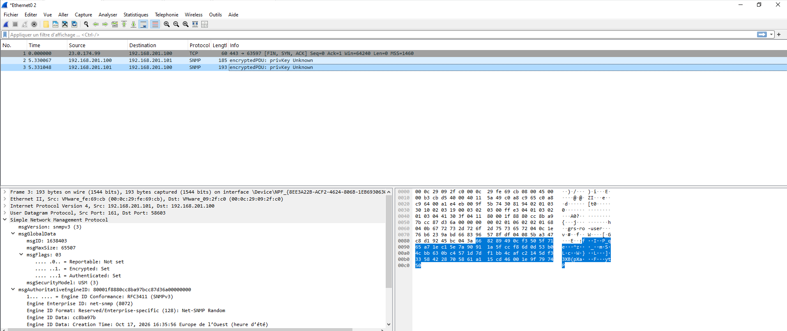

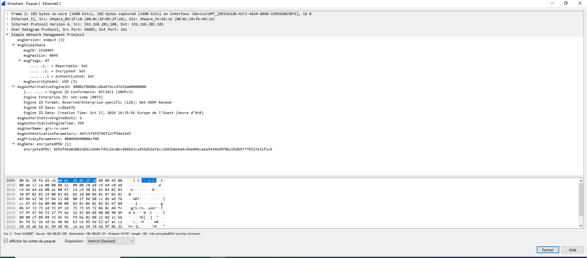

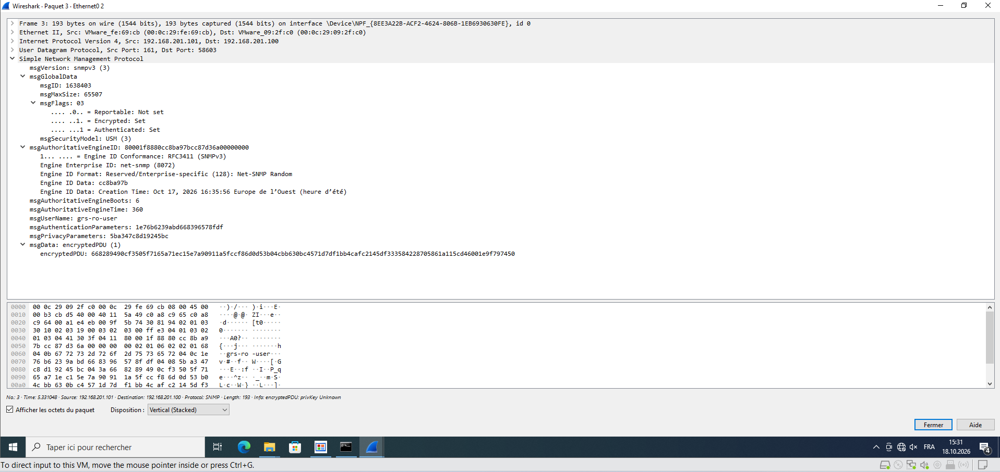

Trame 2 : requête `192.168.201.100` → `192.168.201.101:161`. Trame 3 : réponse.

| Champ | Observé | Impact sécurité |
|---|---|---|
| `msgVersion` | snmpv3 (3) | Plus de communauté : modèle par utilisateur |
| `msgFlags` | `Authenticated` + `Encrypted` | Niveau **authPriv** |
| `msgSecurityModel` | USM (3) | Sécurité basée sur l'utilisateur |
| `msgUserName` | `grs-ro-user`, lisible en clair | Identité exposée, mais pas le secret |
| `msgAuthenticationParameters` | Empreinte HMAC-SHA | **Intégrité et authenticité** : un message modifié ou forgé est rejeté |
| `msgAuthoritativeEngineID`, `EngineBoots` (6), `EngineTime` (359) | Identifiant et horloge de l'agent | **Anti-rejeu** : un message trop ancien est refusé |
| `msgPrivacyParameters` | Sel AES | Chaque message est chiffré différemment |
| `msgData` | `encryptedPDU` (Wireshark : « privKey Unknown ») | **Confidentialité** : OID et valeur illisibles |

**Comparaison avec v2c (Q6/Q7)** : en v2c, la communauté, l'OID et la valeur (`GRS_rtr`) étaient lisibles, et rien n'authentifiait l'émetteur. En v3 authPriv, le contenu est chiffré (AES) et chaque message porte une empreinte HMAC-SHA qui garantit son intégrité et l'identité de l'émetteur.

**Limites** : le nom d'utilisateur, l'engineID et les métadonnées (adresses, ports, taille) restent visibles. La sécurité repose sur la robustesse des mots de passe, faibles ici car imposés par le labo.

---

# Utilisation de l'IA

Une IA générative (Claude) a été utilisée pour aider à la résolution de blocages ainsi qu'à la mise en forme et à la rédaction partielle de ce rapport. Les manipulations et les captures ont été réalisées par l'étudiant.
