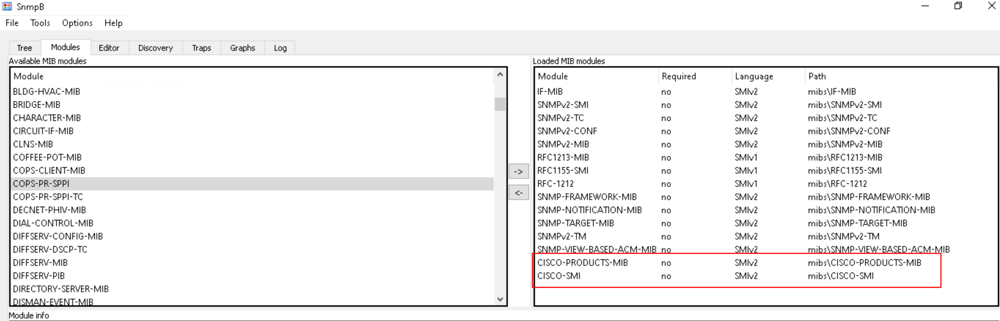
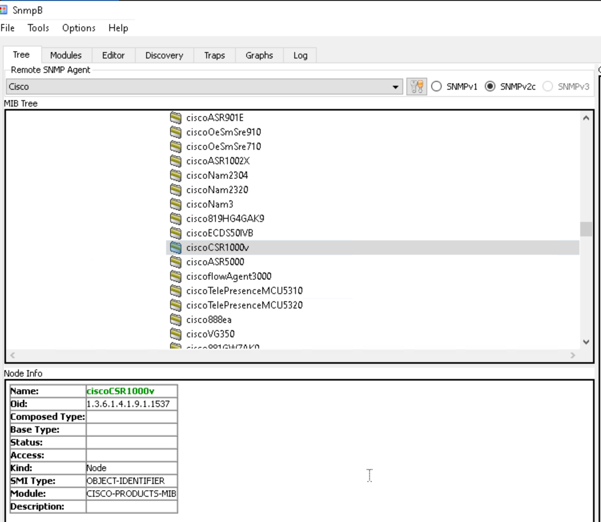
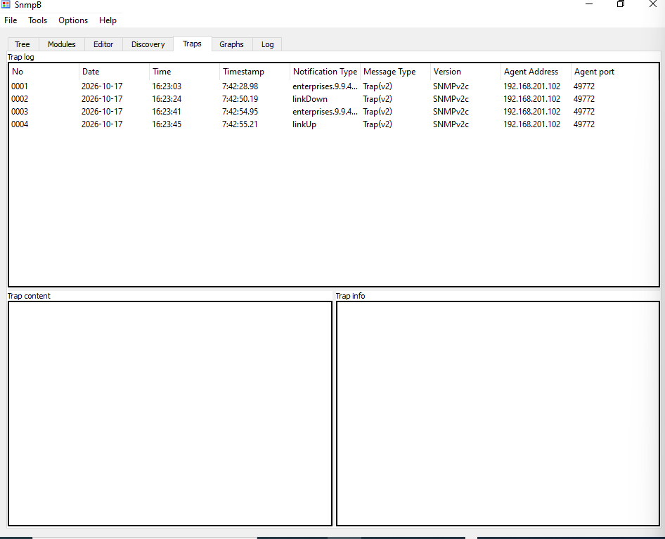
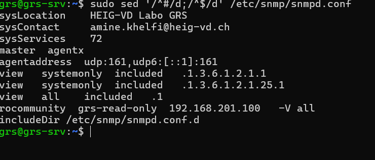

| Machine | Rôle | Adresse IP |
| --- | --- | --- |
| Windows 10 (`win10-GRS-A`) | Console SNMP (snmpB), Wireshark, agent SNMP | `192.168.201.100` |
| Ubuntu (`grs-srv`) | Agent SNMP (snmpd) | `192.168.201.101` |
| Cisco CSR 1000V | Agent SNMP | `192.168.201.102` |

\newpage

# 2.2 Configuration des agents en SNMP v2c

## 2.2.1 Poste de travail Windows

### Question 1

Configuration du service SNMP Windows (onglet *Sécurité*) :

- ajout de la communauté `grs-read-only` avec le droit **LECTURE SEULE** ;
- paquets SNMP acceptés uniquement depuis `localhost`, puisque snmpB tourne sur la même machine.

Le service SNMP est ensuite redémarré pour appliquer la configuration.

{ height=250px }

\newpage

### Question 2

Interrogation de l'agent SNMP local (profil `localhost`) avec snmpB :

| Objet | OID | Valeur retournée | Vérification |
| --- | --- | --- | --- |
| sysDescr | 1.3.6.1.2.1.1.1 | Hardware: Intel64 Family 6 Model 154 Stepping 4 AT/AT COMPA... | Vrai selon les paramètres de l'host et de l'hyperviseur |
| sysName | 1.3.6.1.2.1.1.5 | win10-GRS-A | Vrai |
| sysUpTime | 1.3.6.1.2.1.1.3 | 0:07:55.94 | Vrai dans le détail de la carte réseau mais la VM était éteinte entre deux |
| ifNumber | 1.3.6.1.2.1.2.1 | 28 | Faux (Get-NetIPInterface).Count $\rightarrow$ 4 |
| ipAdEntAddr | 1.3.6.1.2.1.4.20.1.1 | 192.168.201.100 | Vrai |

{ height=250px }

{ height=250px }

\newpage

{ height=250px }

{ height=250px }

\newpage

{ height=250px }

## 2.2.2 Routeur Cisco

### Question 3

```bash
enable
configure terminal

! --- SNMP v2c ---
snmp-server community ciscoRO RO
snmp-server community ciscoRW RW
snmp-server location HEIG-VD Labo GRS
snmp-server contact amine.khelfi@heig-vd.ch

! --- Traps vers snmpB (Windows 192.168.201.100) ---
snmp-server host 192.168.201.100 version 2c ciscoRO
snmp-server enable traps snmp authentication linkdown linkup coldstart warmstart
snmp-server enable traps config

! --- Horodatage à la milliseconde, en heure locale ---
service timestamps debug datetime msec localtime show-timezone
service timestamps log datetime msec localtime show-timezone

! --- Synchronisation du temps (NTP METAS) ---
clock timezone CET 1 0
clock summer-time CEST recurring last Sun Mar 2:00 last Sun Oct 3:00
ntp server 195.176.26.205

end
write memory
```

\newpage

### Question 4

Interrogation du routeur Cisco (profil `Cisco`, SNMPv2c) avec snmpB :

| Objet | OID | Valeur retournée |
| --- | --- | --- |
| sysDescr | 1.3.6.1.2.1.1.1 | Cisco IOS Software [Amsterdam], Virtual XE Software (X8... |
| sysName | 1.3.6.1.2.1.1.5 | GRS_rtr |
| sysUpTime | 1.3.6.1.2.1.1.3 | 7:00:43.72 |
| sysObjectID | 1.3.6.1.2.1.1.2 | enterprises.9.1.1537 |
| ipAdEntAddr | 1.3.6.1.2.1.4.20.1.1 | 192.168.201.102 |

{ height=250px }

{ height=250px }

\newpage

{ height=250px }

{ height=250px }

{ height=250px }

\newpage

### Question 5

`sysObjectID` est l'identifiant du type d'équipement, attribué par le constructeur. Il indique à la console SNMP **quel modèle de matériel ou de logiciel**. Cette valeur est un OID de la branche privée `enterprises` (`1.3.6.1.4.1`). Dans cette branche, chaque constructeur reçoit de l'IANA un numéro unique, sous lequel il organise ses propres identifiants.

La valeur retournée, `enterprises.9.1.1537`, correspond à l'OID complet `1.3.6.1.4.1.9.1.1537` :

| Partie | Signification |
| --- | --- |
| `1.3.6.1.4.1` | iso.org.dod.internet.private.enterprises |
| `9` | Numéro d'entreprise IANA attribué à **Cisco Systems** |
| `1` | Branche `ciscoProducts` (identifiants des modèles Cisco) |
| `1537` | Identifiant du modèle précis de l'équipement |

snmpB ne sait traduire que le début de l'OID (`enterprises`), car il ne connaît que les MIBs standards. Pour interpréter la valeur entièrement, il manque la **MIB privée de Cisco** qui définit cette branche : `CISCO-PRODUCTS-MIB`, avec sa dépendance `CISCO-SMI`. Une fois ces MIBs chargées dans snmpB, `1.3.6.1.4.1.9.1.1537` s'affiche sous la forme d'un noeud `ciscoCSR1000v`, c'est-à-dire le routeur virtuel Cisco CSR 1000V. Cela concorde avec le sysDescr (« Virtual XE Software »).

\newpage

{ height=250px }

{ height=250px }

\newpage

### Question 6

Requête GET de `sysName` envoyée au routeur avec snmpB. L'échange se compose de deux trames SNMP (trames 9 et 10) :

{ height=250px }

**Trame 9 : get-request (Windows $\rightarrow$ Cisco)**

{ height=250px }

- **Transport :** UDP, de `192.168.201.100:53635` vers `192.168.201.102:161`. Le port 161 est celui de l'agent SNMP.
- **version :** `v2c (1)`.
- **community :** `ciscoRO`, transmise **en clair**. On la lit directement dans la vue hexadécimale.
- **PDU :** `get-request (0)`.
- **request-id :** `6558`. Cet identifiant permet d'associer la réponse à la requête.
- **error-status / error-index :** `0`, toujours nuls dans une requête.
- **variable-bindings :** un seul objet, `1.3.6.1.2.1.1.5.0`, avec la valeur `Null`, car la console demande la valeur et n'en fournit aucune.

\newpage

**Trame 10 : get-response (Cisco $\rightarrow$ Windows)**

{ height=250px }

- **Transport :** UDP, de `192.168.201.102:161` vers `192.168.201.100:53635`. La réponse revient sur le port source de la requête.
- **community :** `ciscoRO`, recopiée par l'agent.
- **PDU :** `get-response (2)`, avec le même **request-id** `6558` que la requête.
- **error-status :** `noError (0)`, la requête a abouti.
- **variable-bindings :** `1.3.6.1.2.1.1.5.0` = `"GRS_rtr"` (OctetString), soit le nom actuel du routeur.

### Question 7

Modification de `sysName` avec snmpB (opération *Set*). La requête utilise la communauté en écriture `ciscoRW` :

{ height=250px }

\newpage

**Trame 5 : set-request (Windows $\rightarrow$ Cisco)**

{ height=250px }

- **Transport :** UDP, de `192.168.201.100:53635` vers `192.168.201.102:161`.
- **version :** `v2c (1)`.
- **community :** `ciscoRW`, la communauté **en écriture**, elle aussi **en clair**. Toute personne qui capture cette trame peut ensuite modifier la configuration du routeur.
- **PDU :** `set-request (3)`, avec le **request-id** `6559`.
- **variable-bindings :** `1.3.6.1.2.1.1.5.0` = `"routeur-amine"` (OctetString). Contrairement au GET, la requête contient la **nouvelle valeur** à écrire.

**Trame 6 : get-response (Cisco $\rightarrow$ Windows)**

{ height=250px }

- **PDU :** `get-response (2)`. SNMPv2 utilise le même type de PDU pour répondre à un GET et à un SET.
- **request-id :** `6559`, identique à celui de la requête.
- **error-status :** `noError (0)`, la modification est acceptée.
- **variable-bindings :** `sysName.0` = `"routeur-amine"`. L'agent renvoie la valeur écrite pour confirmer l'opération.

> **Remarque :** par erreur, le routeur a été nommé `routeur-amine` au lieu de `router-amine` comme demandé dans l'énoncé. Cela ne change rien à l'échange observé : seule la valeur de la chaîne transmise diffère.

\newpage

**Trame 7 : snmpV2-trap (Cisco $\rightarrow$ Windows, port 162)**

{ height=250px }

Cette modification de la configuration déclenche immédiatement une trap `ciscoConfigManEvent` (`1.3.6.1.4.1.9.9.43.2.0.1`, activée par `snmp-server enable traps config`). Le routeur informe ainsi la console qu'un changement de configuration a eu lieu.

\newpage

### Question 8

Pour générer des traps, une interface Loopback est créée puis désactivée et réactivée :

```bash
configure terminal
interface Loopback1
 ip address 1.1.1.1 255.255.255.255
 shutdown
 no shutdown
end
```

Ces commandes génèrent plusieurs traps, reçues par snmpB (onglet *Traps*) :

| No | Notification | Événement déclencheur |
|---|---|---|
| 0001 | `enterprises.9.9.43...` (ciscoMgmt.43.2.0.1) | Entrée en mode configuration (`configure terminal`) |
| 0002 | `linkDown` | `shutdown` sur Loopback1 |
| 0003 | `enterprises.9.9.43...` (ciscoMgmt.43.2.0.2) | Sortie du mode configuration (`end`) |
| 0004 | `linkUp` | `no shutdown` sur Loopback1 |

Edit : après ajout des MIBs CISCO, les notifications non résolues sont : `ciscoMgmt.43.2.0.1` et `ciscoMgmt.43.2.0.2`.

Toutes les traps sont en SNMPv2c et proviennent de l'agent `192.168.201.102`.

{ height=250px }

\newpage

### Question 9

Les quatre traps apparaissent dans Wireshark (filtre `snmp`), toutes envoyées de `192.168.201.102` vers `192.168.201.100` (port UDP **162**, celui du gestionnaire de traps) :

{ height=250px }

Détail de la trame 287 (trap `linkUp`) :

| Variable-binding | Valeur | Signification |
| --- | --- | --- |
| `1.3.6.1.2.1.1.3.0` (sysUpTime.0) | 2777521 | Instant de l'événement, en centièmes de seconde depuis le démarrage de l'agent |
| `1.3.6.1.6.3.1.1.4.1.0` (snmpTrapOID.0) | `1.3.6.1.6.3.1.1.5.4` | Type de trap : **linkUp** |
| `1.3.6.1.2.1.2.2.1.1.6` (ifIndex.6) | 6 | Index de l'interface concernée |
| `1.3.6.1.2.1.2.2.1.2.6` (ifDescr.6) | `"Loopback1"` | Nom de l'interface |
| `1.3.6.1.2.1.2.2.1.3.6` (ifType.6) | 24 | `softwareLoopback` |
| `1.3.6.1.4.1.9.2.2.1.1.20.6` (locIfReason) | `"up"` | Raison du changement d'état (MIB Cisco) |

Une trap SNMPv2 n'est **pas acquittée** : aucune réponse ne suit ces trames. Pour une notification confirmée, il faudrait utiliser une *inform*. La communauté `ciscoRO` apparaît également en clair.

### Question 10

Une liste d'accès standard n'autorise que la machine Windows. Elle est ensuite associée aux deux communautés :

```bash
configure terminal
access-list 25 permit host 192.168.201.100
access-list 25 deny any log
snmp-server community ciscoRO RO 25
snmp-server community ciscoRW RW 25
end
write memory
```

- `access-list 25 permit host 192.168.201.100` autorise uniquement la console snmpB.
- `access-list 25 deny any log` refuse toute autre source et journalise les tentatives refusées. Un `deny any` implicite existe déjà, mais le rendre explicite permet d'ajouter `log`.
- Le numéro d'ACL ajouté à la fin des commandes `snmp-server community` applique ce filtrage aux requêtes SNMP utilisant ces communautés.

Vérification : `show access-lists 25` affiche le nombre de correspondances pour chaque règle.

\newpage

## 2.2.3 Poste de travail Linux

### Question 11

Après l'installation de `snmpd` (`sudo apt update && sudo apt install snmpd`), la configuration se trouve dans le fichier `/etc/snmp/snmpd.conf`.

Lignes ajoutées ou modifiées :

```bash
# Informations système
sysLocation    HEIG-VD Labo GRS
sysContact     amine.khelfi@heig-vd.ch

# Écouter sur toutes les interfaces (au lieu de 127.0.0.1 seulement)
#agentaddress  127.0.0.1,[::1]
agentaddress  udp:161,udp6:[::1]:161

# Vue donnant accès à tout l'arbre (la vue par défaut "systemonly" est limitée)
view   all    included   .1

# Communauté v2c en lecture seule, limitée à la VM Windows
rocommunity  grs-read-only  192.168.201.100   -V all
```

Configuration effective sur la VM (commentaires et lignes vides masqués) :

{ height=250px }

Redémarrage du service, activation au démarrage et vérification :

```bash
sudo systemctl restart snmpd
sudo systemctl enable snmpd
sudo systemctl status snmpd
```

\newpage

### Question 12

Requête `sysDescr` envoyée au poste Linux depuis snmpB (profil `Ubuntu`, SNMPv2c, communauté `grs-read-only`) :

```text
1: sysDescr.0 Linux grs-srv 5.15.0-194-generic #204-Ubuntu SMP ...
```

L'agent retourne le nom du système (`Linux`), le nom d'hôte (`grs-srv`) et la version du noyau Ubuntu.

{ height=250px }

\newpage

# 2.3 MIBs privées

### Question 13

MIBs ajoutées dans `C:\Program Files (x86)\SnmpB\mibs` puis chargées dans snmpB (onglet *Modules*) :

- `CISCO-FLASH-MIB` : la MIB principale, qui décrit la mémoire flash ;
- ses dépendances : `CISCO-SMI`, `ENTITY-MIB`, `INET-ADDRESS-MIB`, `HCNUM-TC`, `CISCO-QOS-PIB-MIB` ;
- `CISCO-PRODUCTS-MIB`, pour traduire le `sysObjectID` (Question 5).

{ height=250px }

**Démarche :** chez Cisco, les objets de la mémoire flash sont définis dans `CISCO-FLASH-MIB`. Après avoir chargé ce module dans snmpB, le champ *Requires* de l'onglet *Modules* affiche en rouge les modules qui manquent. Nous les avons ajoutées une par une, jusqu'à ce qu'il n'en manque plus aucune. Les MIBs standards (`SNMPv2-SMI`, `SNMPv2-TC`, etc.) étaient déjà fournies avec snmpB. Toutes les autres viennent du dépôt officiel de Cisco : <https://github.com/cisco/cisco-mibs/tree/main>.

\newpage

### Question 14

Les noms des fichiers se trouvent dans la colonne `ciscoFlashFileName` de la table `ciscoFlashFileTable`. On y accède par un *Walk* sur le chemin suivant :

private $\rightarrow$ enterprises $\rightarrow$ cisco $\rightarrow$ ciscoMgmt $\rightarrow$ ciscoFlashMIB $\rightarrow$ ciscoFlashMIBObjects $\rightarrow$ ciscoFlashDevice $\rightarrow$ ciscoFlashPartitions $\rightarrow$ ciscoFlashFiles $\rightarrow$ ciscoFlashFileTable $\rightarrow$ ciscoFlashFileEntry $\rightarrow$ ciscoFlashFileName

Ce chemin correspond à l'OID `1.3.6.1.4.1.9.9.10.1.1.4.2.1.1.5`.

Les 10 premiers fichiers de la mémoire flash sont :

```text
-----SNMP query started-----
1: ciscoFlashFileName.1.1.2 /bootflash/
2: ciscoFlashFileName.1.1.11 /bootflash/lost+found
3: ciscoFlashFileName.1.1.12 /bootflash/csr1000v-mono-universalk9.17.03.02.SPA.pkg
4: ciscoFlashFileName.1.1.13 /bootflash/csr1000v-rpboot.17.03.02.SPA.pkg
5: ciscoFlashFileName.1.1.14 /bootflash/packages.conf
6: ciscoFlashFileName.1.1.15 /bootflash/mode_event_log
7: ciscoFlashFileName.1.1.16 /bootflash/ios_core.p7b
8: ciscoFlashFileName.1.1.17 /bootflash/trustidrootx3_ca.ca
9: ciscoFlashFileName.1.1.18 /bootflash/throughput_monitor_params
10: ciscoFlashFileName.1.1.19 /bootflash/cvac.log
```

L'index `x.y.z` se lit ainsi : numéro du périphérique flash, numéro de la partition, puis numéro du fichier.

{ height=250px }

\newpage

# 2.4 Configuration d'un agent en SNMP v3

### Question 15

snmpd ne crée pas les utilisateurs v3 dans `/etc/snmp/snmpd.conf`, mais dans son fichier de données persistant `/var/lib/snmp/snmpd.conf`. On y écrit une directive `createUser` pendant que le service est arrêté. Au lancement suivant, snmpd lit cette directive, en déduit les clés d'authentification et de chiffrement propres à son EngineID, puis efface la ligne d'origine et la remplace par une entrée `usmUser`. Les deux mots de passe n'apparaissent donc plus sur le disque après le premier démarrage.

```bash
# 1. Arrêter snmpd (sinon il réécrit le fichier persistant à l'arrêt)
sudo systemctl stop snmpd

# 2. Créer l'utilisateur dans le fichier persistant
sudo nano /var/lib/snmp/snmpd.conf
```

Ligne ajoutée (authentification HMAC-SHA, chiffrement AES) :

```text
createUser grs-ro-user SHA secret-password AES secret-key
```

La création du compte ne suffit pas : il faut encore lui donner des droits. C'est le rôle de la directive `rouser` dans `/etc/snmp/snmpd.conf`. Elle autorise `grs-ro-user` à lire seulement, et l'option `authpriv` fait rejeter toute requête de ce compte qui ne serait pas à la fois authentifiée et chiffrée :

```bash
sudo nano /etc/snmp/snmpd.conf
```

```text
rouser grs-ro-user authpriv
```

Redémarrage et vérifications :

```bash
# 3. Redémarrer snmpd
sudo systemctl start snmpd
sudo systemctl status snmpd

# 4. Vérifier que createUser a été converti en clés dérivées (usmUser)
sudo grep -E "usmUser|createUser" /var/lib/snmp/snmpd.conf

# 5. Vérifier la ligne rouser
sudo grep rouser /etc/snmp/snmpd.conf
```

### Question 16

En SNMP v1/v2c, l'accès est donné par les directives de communauté (`rocommunity`, `rwcommunity`, `rocommunity6`, `com2sec`). Pour n'autoriser que SNMP v3, il suffit de toutes les désactiver. Seuls les utilisateurs USM définis par `rouser` / `rwuser` restent alors autorisés.

Recherche des communautés actives :

```bash
sudo grep -n -E "^\s*(rocommunity|rocommunity6|rwcommunity|com2sec)" /etc/snmp/snmpd.conf
```

Chaque ligne trouvée est commentée dans `/etc/snmp/snmpd.conf` :

```bash
sudo nano /etc/snmp/snmpd.conf
```

```bash
#rocommunity  grs-read-only  192.168.201.100  -V all
#rocommunity  public  default    -V systemonly
#rocommunity6 public  default    -V systemonly
```

La ligne de l'utilisateur SNMPv3 est conservée :

```text
rouser grs-ro-user authpriv
```

\newpage

Redémarrage et vérification :

```bash
sudo systemctl restart snmpd

# Une requête v2c ne reçoit plus de réponse (timeout)
snmpget -v2c -c grs-read-only localhost 1.3.6.1.2.1.1.5.0

# Une requête v3 authPriv fonctionne toujours
snmpget -v3 -l authPriv -u grs-ro-user -a SHA -A secret-password -x AES -X secret-key localhost 1.3.6.1.2.1.1.5.0
```

### Question 17

Requête `sysName` envoyée au poste Linux en SNMPv3 (authPriv) depuis snmpB :

{ height=250px }

**Trame 2 : requête (Windows $\rightarrow$ Linux)**

{ height=250px }

\newpage

**Trame 3 : réponse (Linux $\rightarrow$ Windows)**

{ height=250px }

**Ce qui change par rapport aux captures v2c (Q6 et Q7) :**

En v2c, la capture montrait tout en clair : la communauté, l'OID et la réponse `"GRS_rtr"`. En v3 :

1. **Le mot de passe ne circule plus.** Le champ `community` disparaît. Le message ne contient que le nom d'utilisateur (`grs-ro-user`) et un code HMAC-SHA calculé à partir du mot de passe.
2. **Le contenu est chiffré.** La PDU devient un bloc `encryptedPDU` (AES). Wireshark affiche `privKey Unknown`, donc on ne voit ni l'OID ni la valeur.
3. **Un message modifié est rejeté.** Le HMAC couvre tout le message. Les `msgFlags` à `0x03` (Authenticated + Encrypted) confirment le niveau authPriv.
4. **Un message ancien est refusé.** `EngineBoots` et `EngineTime` empêchent de rejouer une requête capturée.

Restent lisibles : les adresses IP, les ports, le nom d'utilisateur et l'EngineID.

\newpage

# Utilisation de l'IA

Une IA générative a été utilisée comme aide ponctuelle : relecture du rapport et reformulation de certaines explications. Les configurations, les manipulations et les captures ont été réalisées par nous sur l'infrastructure du laboratoire.
